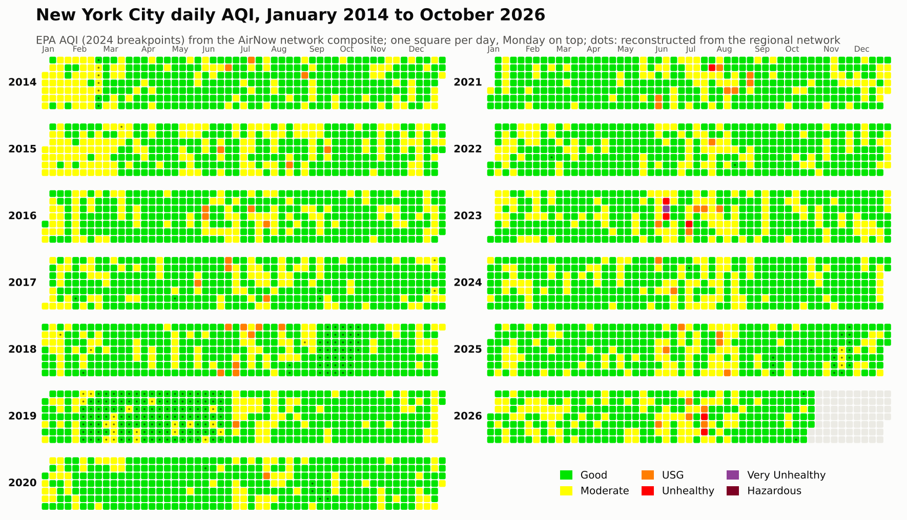
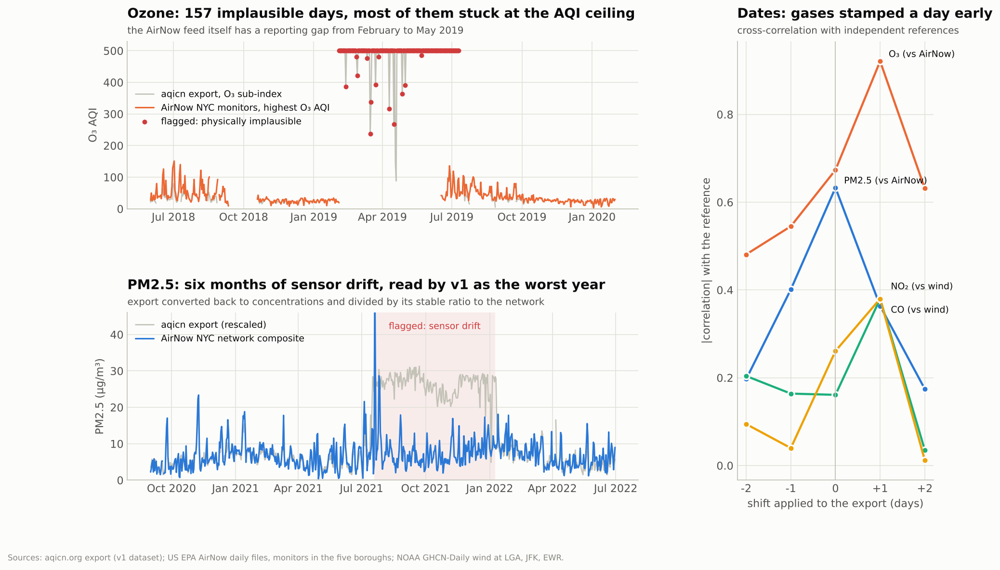
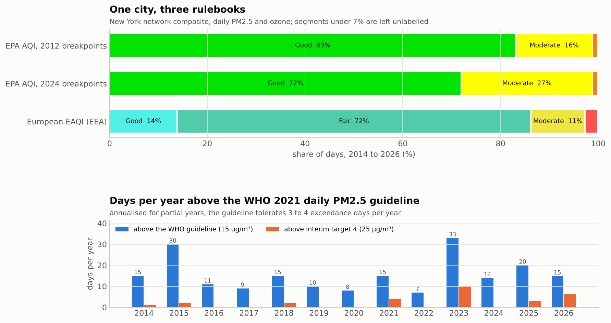
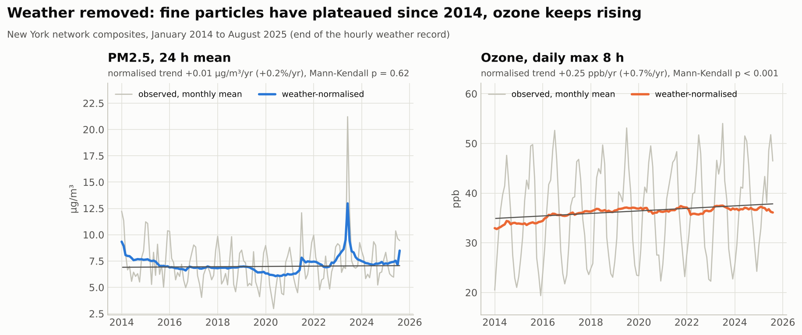
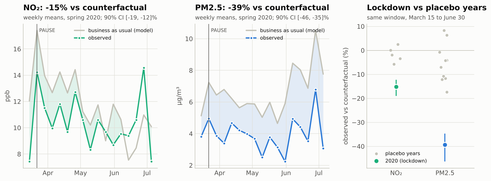
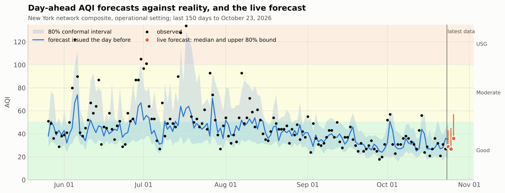
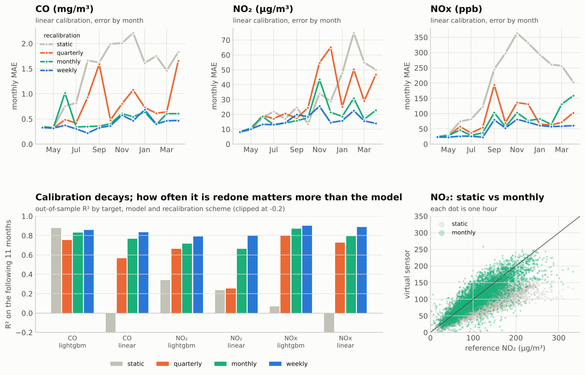
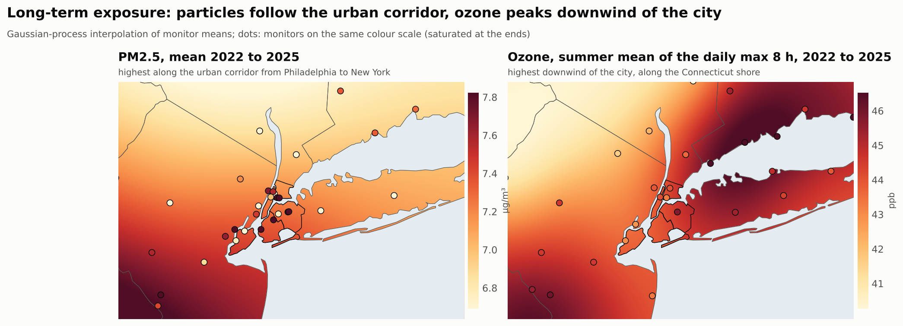
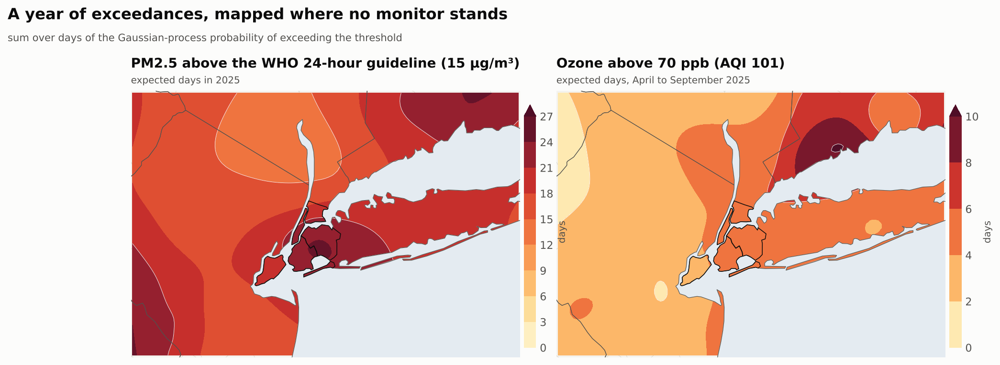
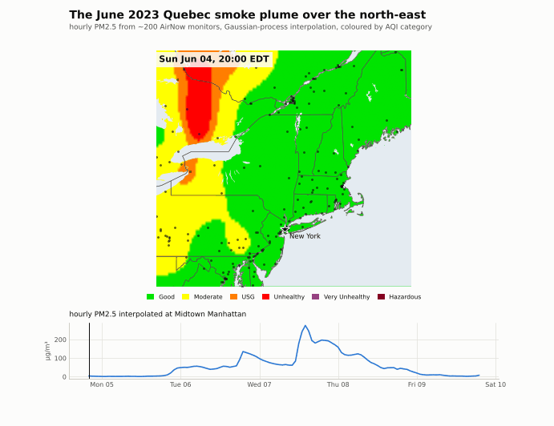

# AQI v2 · Quality-controlled, multi-standard, forecastable and mapped

*Florian Grolleau · Sciences Po Saint-Germain-en-Laye / CY Tech · version 2, October 2026*

Version 2 rebuilds the project around four ideas: **read the data correctly**, **check it
against independent sources**, **model with honest validation and calibrated uncertainty**,
and **map air quality where no monitor stands**. Everything runs on public data (US EPA
AirNow, NOAA, Natural Earth, UCI) with a snapshot up to **October 23, 2026**.



## Highlights

1. **Version 1 read the New York file on the wrong scale.** `NYpollutants.csv` (aqicn.org)
   contains US EPA AQI sub-indices, not concentrations. v1 pushed them through concentration
   breakpoints: on the days it used, it classified 1% of days as "Good" instead of
   78%.
2. **Four silent data failures**, found by cross-checking 14 EPA monitors and NOAA weather:
   the gases of the export are stamped one day early, ozone is stuck at the AQI ceiling for
   157 days in 2019, PM2.5 drifts for six months (July 2021 to January 2022, the
   "worst year" of v1), and in the EPA feed itself a Bronx ozone monitor reported 0 ppb for
   all of 2014.
3. **A validated multi-standard AQI engine** (`aqi2.indices`): it reproduces
   159,138 official AirNow ozone AQI values exactly and PM2.5 within one point in
   99.95% of cases; it implements the 2024 EPA PM2.5 revision, the European EAQI,
   the Citeair CAQI, Canada's additive AQHI and the WHO 2021 guidelines.
4. **Same air, different verdicts**: New York is "Good" on 83% of days under the
   2012 EPA table, 72% under the 2024 table and 14% under the European
   index; the WHO 24-hour PM2.5 guideline is exceeded 7 to 33 days a year.
5. **Trends without the weather** (meteorological normalisation): PM2.5 is flat since 2014,
   ozone rises by 0.25 ppb per year, the signature of reduced NO titration.
6. **Event attribution**: June 7, 2023 Quebec smoke (city-wide 24 h PM2.5 154
   µg/m³, AQI 229), a July 2026 haze episode, Independence Day fireworks
   (+5.6 µg/m³), and the COVID-19 lockdown (NO₂ 15% and PM2.5 39%
   below their business-as-usual counterfactuals, outside every placebo year).
7. **Probabilistic forecasting**: day-ahead forecasts beat persistence and climatology
   (ozone skill 42% against persistence with a weather forecast); conformal
   calibration brings the 80% intervals from 70% to about 80% coverage; a live
   forecast for October 24, 2026 (AQI 29, Good).
8. **Low-cost sensors (UCI, Italy)**: the benzene "reference" is a polynomial of one sensor
   (R² = 0.99998), calibrations decay within months unless redone monthly, and the
   recalibrated virtual sensors match the reference CAQI level 75% of the hours.
9. **Geospatial prediction**: seven interpolators under spatial cross-validation (the
   Gaussian process wins for PM2.5 with R² 0.94, kriging plus a boosted residual
   model wins for ozone), exceedance-probability maps, an hourly animation of the 2023
   smoke plume, next-day forecast maps and population-weighted exposure by borough
   (7.1 µg/m³, 1.4 times the WHO annual guideline).

## Gallery

| | |
|---|---|
|  |  |
| Quality control of the v1 data against EPA and NOAA | One city, three rulebooks |
|  |  |
| Weather-normalised trends | COVID-19 lockdown vs placebo years |
|  |  |
| Day-ahead forecasts and the live forecast | Low-cost sensors: calibration decay |
|  |  |
| Long-term exposure maps | Expected exceedance days, 2025 |



Interactive maps (open in a browser): [`maps/nyc_air_quality_map.html`](maps/nyc_air_quality_map.html)
(exposure layers, monitors, boroughs, forecast) and
[`maps/smoke_june2023.html`](maps/smoke_june2023.html) (time slider over the smoke episode).

## Contents

```
v2/
  aqi2/                 Python package
    indices.py          AQI engine: EPA 2012/2024, EAQI, CAQI, AQHI, WHO 2021, inverse AQI
    qc.py               automatic QC of monitor series (impossible and stuck values)
    data.py             loaders for every dataset
    features.py         calendar, lag and rolling features, direct multi-horizon datasets
    forecasting.py      quantile LightGBM + conformal calibration, baselines, scores
    spatial.py          IDW, kriging (with closed-form LOO), Gaussian processes, RFSI features
    viz.py              plotting system (palette, AQI colours, maps, calendars)
  notebooks/
    01_nyc_aqi_v2.ipynb             New York: QC, standards, trends, events, forecasting
    02_uci_virtual_sensing.ipynb    Italy: v1 audit, virtual sensors, hourly CAQI forecast
    03_geospatial_nyc.ipynb         Maps, spatial benchmark, smoke plume, forecast maps
    py/                             the same notebooks as plain Python (jupytext)
  scripts/              data download, notebook build, report build, dashboard export
  data/                 data snapshot (AirNow, NOAA, Natural Earth), processed outputs and
                        the dashboard files (data/dashboard)
  figures/  maps/       exported figures, animation and interactive maps
  report/               LaTeX report (AQI_v2_report.pdf)
  tests/                unit tests of the engine and models
```

## Reproduce

```bash
pip install -r v2/requirements.txt
cd v2
python -m pytest tests                       # engine and model tests
python scripts/fetch_airnow.py daily --start 2014-01-01 --end 2026-10-23   # optional: refresh data
python scripts/fetch_weather.py --start 2014-01-01 --end 2026-10-23
python scripts/fetch_basemap.py
python scripts/build_notebooks.py            # executes the three notebooks (about 40 min)
python scripts/make_report.py                # fills and compiles the report
python scripts/export_dashboard.py           # data files of the interactive dashboard
```

The hourly AirNow extracts used in notebook 03 come from:

```bash
python scripts/fetch_airnow.py hourly --start 2023-06-05T00 --end 2023-06-09T23 \
    --bbox 38.5 47.5 -81.0 -67.0 --params PM2.5 OZONE NO2 --out data/airnow/airnow_hourly_smoke_2023.csv.gz
python scripts/fetch_airnow.py hourly --start 2024-01-01T00 --end 2024-12-31T23 --step-hours 5 \
    --params NO2 OZONE PM2.5 --out data/airnow/airnow_hourly_2024_every5h.csv.gz
```

## Methods in brief

* **AQI**: EPA piecewise-linear breakpoints with the prescribed truncation, maximum over
  pollutants; exact inverse for published AQI values; EEA bands, Citeair grid, AQHI
  formula (Stieb et al., 2008), WHO 2021 guideline values and interim targets.
* **Quality control**: lagged cross-correlation against independent references (dates),
  physical plausibility (ozone ceiling), robust rolling ratio to the network (drift),
  stuck-value runs, and a two-stage regional model to bridge reporting gaps.
* **Network composite**: anomaly-method mean of the monitors, robust to monitors joining
  or leaving.
* **Trends**: meteorological normalisation by resampling (Grange and Carslaw, 2019),
  Theil-Sen slope and Mann-Kendall test on STL-deseasonalised monthly means.
* **Counterfactuals**: business-as-usual model trained outside the COVID-19 period;
  robust effect (median daily log ratio) with weekly block bootstrap; in-time placebo test
  on every other spring.
* **Forecasting**: direct multi-horizon LightGBM with quantile losses, conformalised
  quantile regression (Romano et al., 2019), walk-forward evaluation against persistence
  and climatology, exact TreeSHAP explanations.
* **Spatial prediction**: pooled standardised variogram, ordinary kriging, Gaussian
  processes (Matern 3/2) with daily hyperparameters, RFSI (Sekulic et al., 2020) with
  LightGBM, kriging plus boosted leave-one-out residuals; grouped 8-fold spatial
  cross-validation; exceedance probabilities summed into expected exceedance days.

## Data notes

* AirNow files are real-time data, not the final regulatory archive (EPA AQS).
* NOAA Global Hourly files on AWS stop in August 2025; the analyses that need hourly
  weather (normalisation, counterfactuals) stop there, the forecasts use GHCN-Daily, which
  runs to October 2026.
* NO2 is not reported to AirNow by the New York City monitors; the NYC NO2 series comes
  from the (date-corrected) aqicn export.
* Population weights: 2020 Census counts of the five boroughs.

## References

* De Vito, S. et al. (2008). On field calibration of an electronic nose for benzene
  estimation in an urban pollution monitoring scenario. *Sensors and Actuators B*, 129(2).
* Grange, S. K., Carslaw, D. C. (2019). Using meteorological normalisation to detect
  interventions in air quality time series. *Science of the Total Environment*, 653.
* Romano, Y., Patterson, E., Candes, E. (2019). Conformalized quantile regression. *NeurIPS*.
* Sekulic, A. et al. (2020). Random Forest Spatial Interpolation. *Remote Sensing*, 12(10).
* Stieb, D. M. et al. (2008). A new multipollutant, no-threshold air quality health index.
  *Journal of the Air and Waste Management Association*, 58(3).
* US EPA (2024). Technical Assistance Document for the Reporting of Daily Air Quality.
* WHO (2021). WHO global air quality guidelines.
